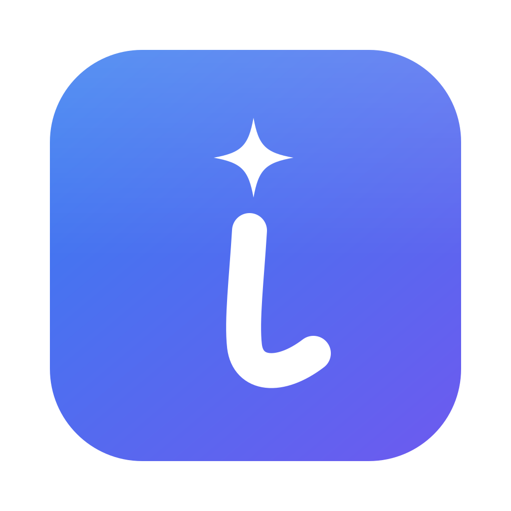
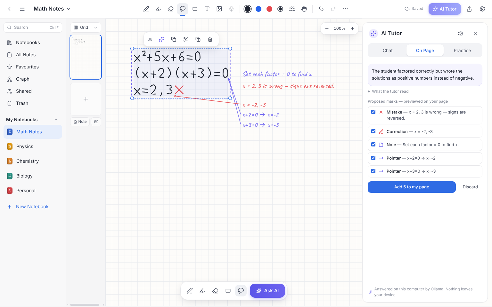
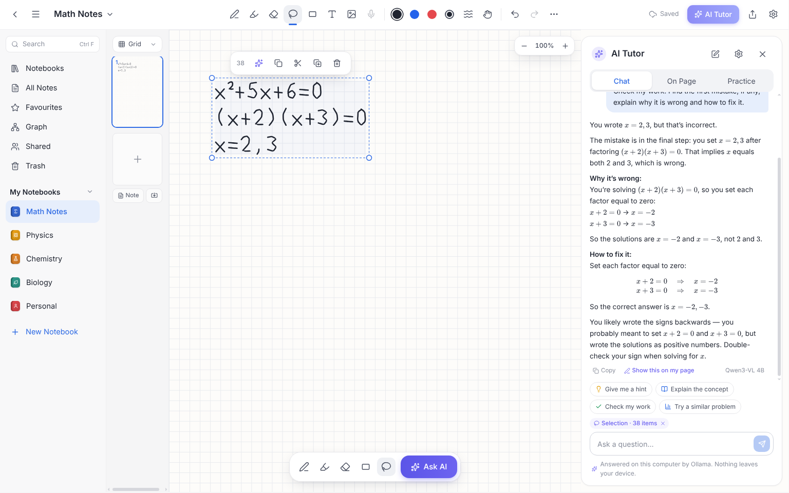
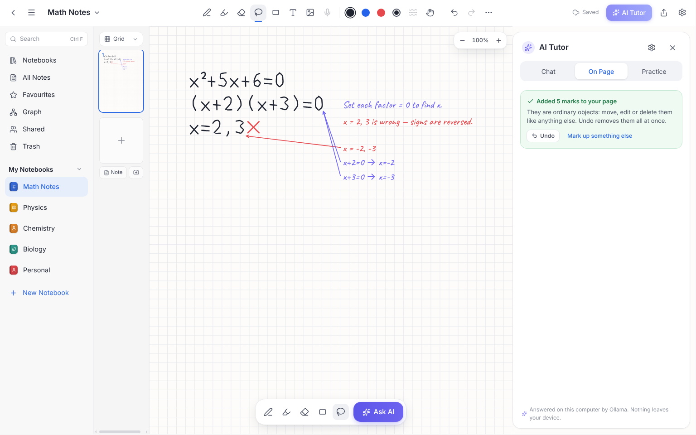

<div align="center">



# Inkling

**Write by hand. Get unstuck.**

Handwritten notes on your computer, with an AI tutor that reads your working and marks it up on the page.

[**⬇ Download Inkling**](https://supergithubduo.github.io/inkling-notebook/)
&nbsp;·&nbsp; [Install guide](docs/INSTALL.md)
&nbsp;·&nbsp; [User guide](docs/USER-GUIDE.md)
&nbsp;·&nbsp; [Privacy](docs/PRIVACY.md)
&nbsp;·&nbsp; [Feedback &amp; support](SUPPORT.md)

Free beta · Windows 10/11 · macOS 12 or later

</div>

<p align="center">
  
</p>

## Download

**[Go to the download page →](https://supergithubduo.github.io/inkling-notebook/)** It picks the right file for your computer, and every download comes straight from this project's official GitHub releases.

| Your computer | What to download |
|---|---|
| **Windows 10 or 11** (including ARM PCs such as Surface Pro X, through Windows' built-in emulation) | `Inkling-Setup-<version>-x64.exe` |
| **Mac with Apple silicon** (M1 or later — *Apple menu → About This Mac* says "Chip: Apple M…") | `Inkling-<version>-arm64.dmg` |
| **Mac with an Intel processor** (*About This Mac* says "Processor: … Intel …") | `Inkling-<version>-x64.dmg` |

**You don't need** Node.js, npm, a GitHub account, an API key, an Inkling account or anything else. Download one file, open it, and you're writing in a couple of minutes.

> [!IMPORTANT]
> **The beta isn't code-signed yet**, so the first time you open it Windows shows *"Windows protected your PC"* (click **More info → Run anyway**) and macOS says it can't verify the developer (open **System Settings → Privacy & Security → Open Anyway**). Only download Inkling from the download page above or this repository's [Releases](https://github.com/SuperGithubDuo/inkling-notebook/releases). The [install guide](docs/INSTALL.md) walks you through it, including how to check your download's SHA-256 checksum.

If the download page says no release is available yet, the beta hasn't been published — please check back soon.

## What you can do with Inkling

<table>
<tr>
<td width="50%" valign="top">

**✍️ Write and draw naturally**<br>
Pen, highlighter, precise or whole-stroke eraser, shapes, text and images. Lasso to move, resize and restyle. Zoom, pan, undo and redo. Grid, lined, dotted or blank paper.

**📄 Annotate PDFs**<br>
Import lecture slides or handouts, write on them, and export the annotated notebook as a PDF. The original pages are kept unchanged.

**🗂️ Typed notes beside your handwriting**<br>
Headings, lists, checklists, tables, code and LaTeX formulas, with Markdown import and export.

</td>
<td width="50%" valign="top">

**🔗 Connected notes**<br>
Search titles, tags, typed text and PDF text. Link pages with `[[links]]`, see backlinks, and explore everything as a knowledge graph.

**✨ An AI tutor that reads your working**<br>
Circle your work and ask. Get a hint instead of the answer, have your steps checked, or practise similar problems. Corrections appear on your page as a preview — you choose what to keep.

**🔒 Your notebooks stay yours**<br>
Saved on your computer as you write, backed up every day, with one-click restore. No account, no tracking.

</td>
</tr>
</table>

<p align="center">
  
  
</p>

## The AI tutor, in plain words

- **Free, with a daily limit.** About 10 answers a day per computer, with nothing to set up. When the allowance runs out, the tutor pauses and the rest of Inkling works as usual. It never costs you anything.
- **Only what you ask about is sent**, and only after you click *Allow*: your question and the part of the page you selected. Inkling's AI server doesn't store it. Prefer nothing to leave your computer? Use the [local Ollama option](docs/AI-PROVIDERS.md#local-ollama-default-in-development-builds) instead.
- **AI answers can be wrong.** Check them. Please don't send personal or sensitive information.
- **Under 18?** A parent or guardian should read the [install guide](docs/INSTALL.md#younger-testers) and decide whether to allow the AI.

## Help, privacy and legal

| | |
|---|---|
| **Install guide** | [docs/INSTALL.md](docs/INSTALL.md) — downloading, security prompts, checksums, uninstalling |
| **User guide** | [docs/USER-GUIDE.md](docs/USER-GUIDE.md) — every tool and shortcut |
| **Feedback and support** | [SUPPORT.md](SUPPORT.md), or *Help → Send Feedback or Report a Problem* in the app |
| **Privacy** | [docs/PRIVACY.md](docs/PRIVACY.md) (plain-language draft, pending legal review) |
| **Release notes** | [RELEASE_NOTES.md](RELEASE_NOTES.md) |
| **Known limitations** | [docs/KNOWN-LIMITATIONS.md](docs/KNOWN-LIMITATIONS.md) |
| **Licence** | Inkling is pre-release software; all rights reserved — see [LICENSE.txt](LICENSE.txt). Open-source components keep their own licences: [THIRD_PARTY_NOTICES.txt](THIRD_PARTY_NOTICES.txt). |

## For developers

Inkling is a desktop app built with Electron, React and TypeScript. Everything technical lives in [`docs/`](docs/README.md):

- [Developing Inkling](docs/DEVELOPMENT.md) — requirements, running from source, all test suites
- [Architecture](docs/ARCHITECTURE.md) — storage, command layer, rendering, security
- [AI providers](docs/AI-PROVIDERS.md) — cloud, local (Ollama) and Gemini, with measured results
- [Building and releasing](docs/RELEASING.md) — installers, signing, the approval-gated release flow
- [Roadmap](docs/ROADMAP.md) and [release readiness](docs/READINESS.md)
- [AI server](beta-server/README.md) — the small Cloudflare Worker behind the free tutor

```bash
npm ci && npm run dev   # Node.js 22.13+ — see docs/DEVELOPMENT.md
```
