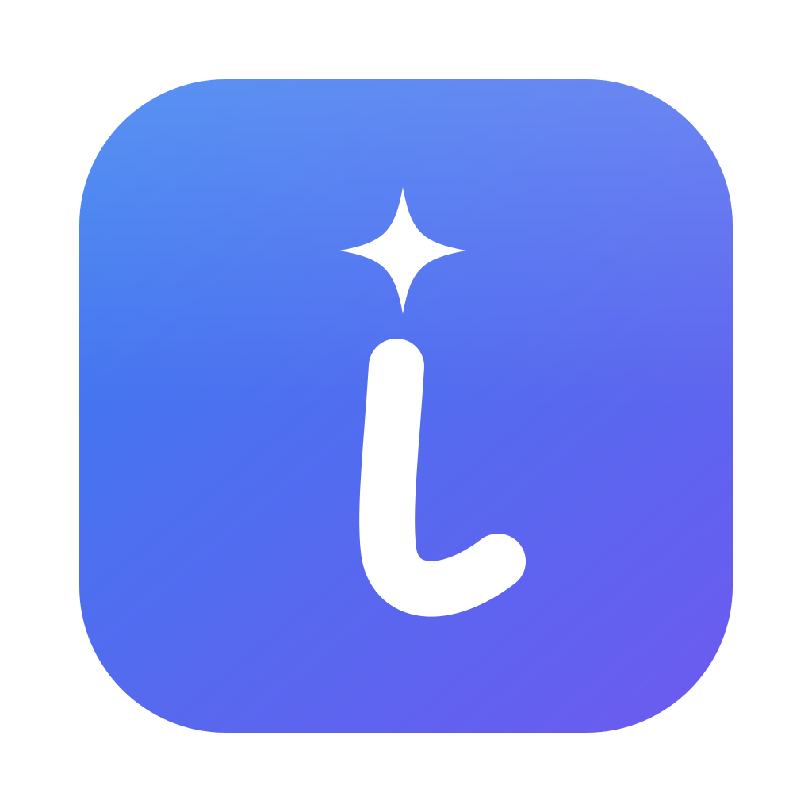
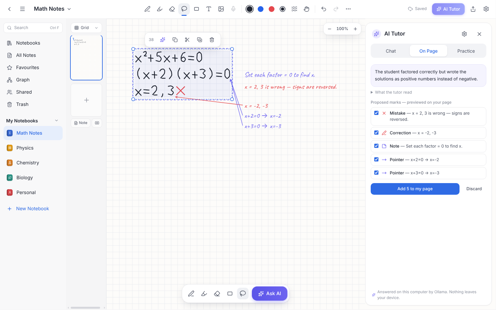
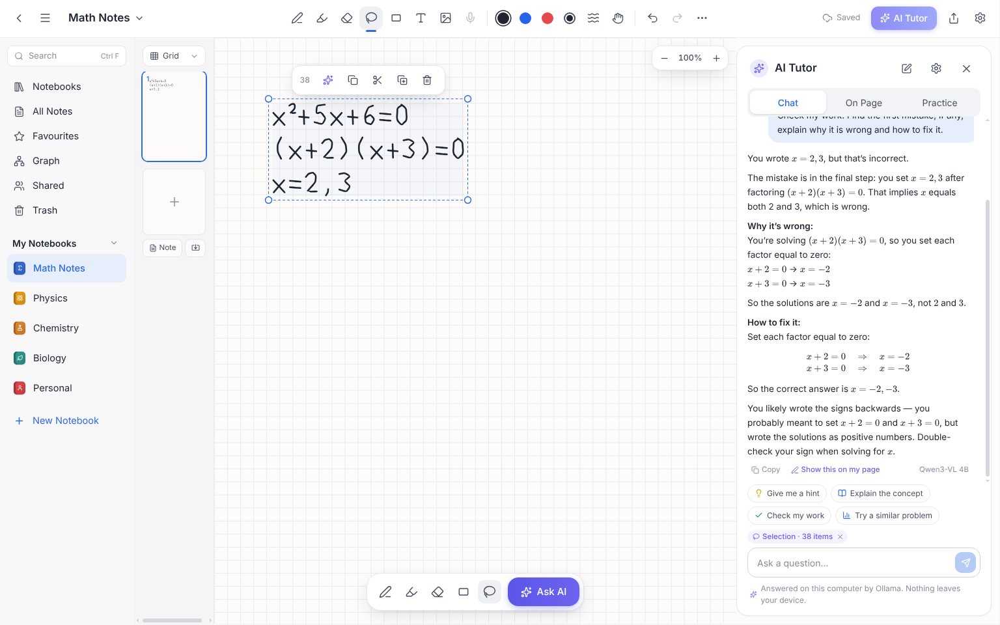
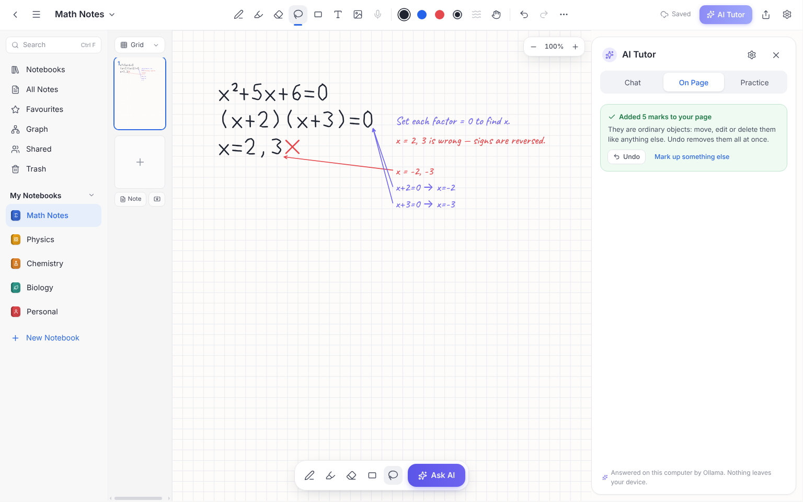

<div align="center">



# Inkling

**think it, ink it, master it.**

Handwritten notes in your browser or on your computer, with an AI tutor that reads your working and marks it up on the page.

[**Open Inkling**](https://supergithubduo.github.io/inkling-notebook/app/)
&nbsp;·&nbsp; [Download for Windows or Mac](https://supergithubduo.github.io/inkling-notebook/download/)
&nbsp;·&nbsp; [Install guide](docs/INSTALL.md)
&nbsp;·&nbsp; [User guide](docs/USER-GUIDE.md)
&nbsp;·&nbsp; [Privacy](docs/PRIVACY.md)
&nbsp;·&nbsp; [Feedback &amp; support](SUPPORT.md)

Free beta · any modern browser (computer, tablet, phone) · Windows 10/11 · macOS 12 or later

**Status:** public beta. The latest version is on the [download page](https://supergithubduo.github.io/inkling-notebook/download/); see [release notes](RELEASE_NOTES.md).

</div>

<p align="center">
  
</p>

## Download

**[Go to the download page →](https://supergithubduo.github.io/inkling-notebook/download/)** It suggests the right file for your computer, and every download comes straight from this project's official GitHub releases. It only offers releases that passed the full build and test checks and were approved.

| Your computer | What to download |
|---|---|
| **Windows 10 or 11** (including ARM PCs such as Surface Pro X, through Windows' built-in emulation) | `Inkling-Setup-<version>-x64.exe` |
| **Mac with Apple silicon** (M1 or later — *Apple menu → About This Mac* says "Chip: Apple M…") | `Inkling-<version>-arm64.dmg` |
| **Mac with an Intel processor** (*About This Mac* says "Processor: … Intel …") | `Inkling-<version>-x64.dmg` |

**You don't need** Node.js, npm, a GitHub account, an API key, an Inkling account or anything else. Download one file, open it, and you're writing in a couple of minutes.

> [!IMPORTANT]
> **The beta isn't code-signed yet**, so the first time you open it Windows shows *"Windows protected your PC"* (click **More info → Run anyway**) and macOS says it can't verify the developer (open **System Settings → Privacy & Security → Open Anyway**). Only download Inkling from the download page above or this repository's [Releases](https://github.com/SuperGithubDuo/inkling-notebook/releases). The [install guide](docs/INSTALL.md) walks you through it, including how to check your download's SHA-256 checksum.

## What you can do with Inkling

<table>
<tr>
<td width="50%" valign="top">

**✍️ Write and draw naturally**<br>
Pen, highlighter, precise or whole-stroke eraser, shapes, text and images. Lasso to move, resize and restyle. Zoom, pan, undo and redo. Grid, lined, dotted or blank paper.

**📄 Annotate PDFs**<br>
Import lecture slides or handouts, write on them, and export the annotated notebook as a PDF. The original pages are kept unchanged.

**🗂️ Typed notes beside your handwriting**<br>
Headings, lists, checklists, tables, code and LaTeX formulas, with Markdown import and export.

</td>
<td width="50%" valign="top">

**🔗 Connected notes**<br>
Search titles, tags, typed text and PDF text. Link pages with `[[links]]`, see backlinks, and explore everything as a knowledge graph.

**✨ An AI tutor that reads your working**<br>
Circle your work and ask. Get a hint instead of the answer, have your steps checked, or practise similar problems. Corrections appear on your page as a preview — you choose what to keep.

**🔒 Your notebooks stay yours**<br>
Saved on your device as you write, backed up every day on the desktop, with one-click restore. No account needed (sign in only if you want your notebooks synced between devices), no ads, no analytics.

</td>
</tr>
</table>

<p align="center">
  
  
</p>

**Not yet:** handwriting isn't searchable, audio recording and sharing aren't built (the screenshots show their menu entries, which are marked as unavailable in the app), and there's no iPad, Android or web version. Real pens and touch screens haven't been tested on physical devices yet. More in [known limitations](docs/USER-GUIDE.md#known-limitations).

## The AI tutor, in plain words

- **Free, with limits.** About 12 answers a day per computer (longer answers use more), a monthly limit per computer, and a shared budget for everyone together, so on a busy day the tutor can stop earlier. When an allowance runs out, or the AI provider is briefly unavailable, the tutor pauses and the rest of Inkling works as usual. It never costs you anything.
- **Nothing is sent until you click *Allow*** — not even a check of how many answers are left. Then, when you ask, Inkling sends Inkling's AI server your question, what you include with it (an image of your selection, or the page's title, typed text, PDF text and an image of its handwriting), and the recent conversation on that page (up to your last 5 questions, the tutor's answers and the most recent earlier image). The server gets the answer from an AI model (Qwen 3.8 27B) hosted by DeepInfra, with Cloudflare Workers AI as a backup. Versions before 0.2.0-beta.3 keep using Cloudflare Workers AI until they are updated. Inkling's server doesn't store or log your questions, images or answers. Both providers say they don't use them for training and don't keep them after answering, apart from limited exceptions such as support cases and legal obligations.
- **What else goes with a question:** an anonymous installation ID (a random number the app makes) and your internet address, used only to share out the free limits. The server keeps them only as scrambled counts: daily counts are replaced every day, and each computer's monthly count at the end of the month.
- **One *Allow* covers everyone on that computer account,** and it doesn't verify a parent's or guardian's consent.
- **Prefer nothing to leave your computer?** Use the [local Ollama option](docs/AI.md#local-ollama-default-in-development-builds) instead. It needs a separate free app (Ollama) and a 2–6 GB model download.
- **AI answers can be wrong.** Check them. Please don't send personal or sensitive information.
- **Under 18?** Inkling doesn't check ages, and clicking *Allow* isn't verified parental consent. A parent or guardian should read the [privacy notice](docs/PRIVACY.md) and the [install guide](docs/INSTALL.md#younger-testers), install Inkling, and decide whether to allow the AI. Inkling's handling of children's data hasn't been reviewed by a lawyer yet.

Inkling also asks GitHub whether a newer version exists when it starts; GitHub sees your internet address and app version, as with any download.

## Help, privacy and legal

| | |
|---|---|
| **Install guide** | [docs/INSTALL.md](docs/INSTALL.md) — downloading, security prompts, checksums, uninstalling |
| **User guide** | [docs/USER-GUIDE.md](docs/USER-GUIDE.md) — every tool and shortcut |
| **Feedback and support** | [SUPPORT.md](SUPPORT.md) |
| **Privacy** | [docs/PRIVACY.md](docs/PRIVACY.md): a plain-language **draft**, pending legal review. Who runs Inkling and how to contact them are still to be filled in |
| **Release notes** | [RELEASE_NOTES.md](RELEASE_NOTES.md) |
| **Known limitations** | [docs/USER-GUIDE.md](docs/USER-GUIDE.md#known-limitations) |
| **Licence** | Inkling is pre-release software; all rights reserved — see [LICENSE.txt](LICENSE.txt). Open-source components keep their own licences: [THIRD_PARTY_NOTICES.txt](THIRD_PARTY_NOTICES.txt). |

## For developers

Inkling is a desktop app built with Electron, React and TypeScript. Everything technical lives in [`docs/`](docs/README.md):

- [Developing Inkling](docs/DEVELOPMENT.md) — requirements, running from source, all test suites
- [Architecture](docs/ARCHITECTURE.md) — storage, command layer, rendering, security
- [AI Tutor](docs/AI.md) — how it works, providers (cloud, local Ollama, Gemini), guarantees, measured results
- [Building and releasing](docs/RELEASING.md) — installers, signing, the approval-gated release flow, the download site
- [Roadmap](docs/ROADMAP.md) — what's verified and what's left
- [AI server](beta-server/README.md) — the small Cloudflare Worker behind the free tutor

```bash
npm ci && npm run dev   # Node.js 22.13+ — see docs/DEVELOPMENT.md
```
